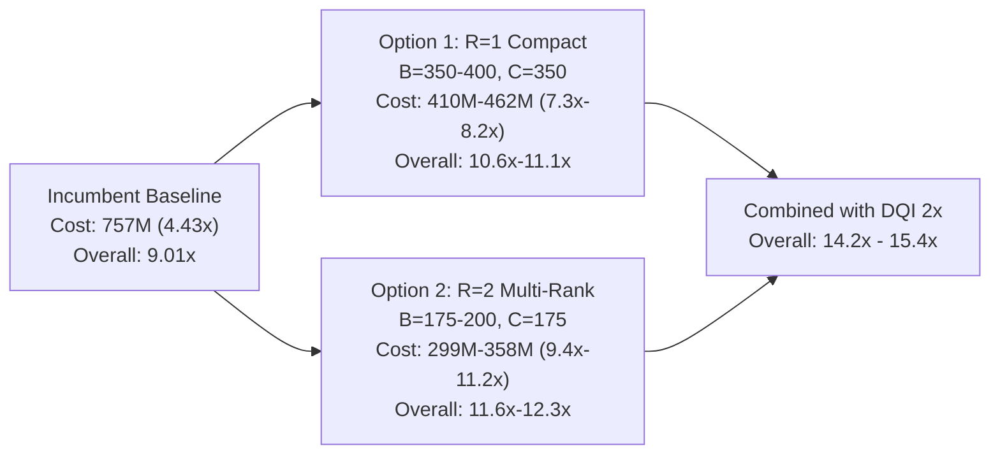

# Research Report: Global Chemistry Atom Generation & Architecture Scaling

**Session Date**: 2026-10-24  
**Working Directory**: [`/media/shared/ExpansionDrive2/QuantumAI/initial_experiments/4/agy`](file:///media/shared/ExpansionDrive2/QuantumAI/initial_experiments/4/agy)  
**Incumbent Benchmark III (Chemistry)**: Cost **757,163,489.50** ($4.432\times$, $R=1, B=719, C=350, \text{brot}=8, Q=526, T=29,440$)  
**Overall Verified Score**: **9.009623×** (All 50,880 shots verified on host)

---

## 1. Executive Summary & Core Results

To push the overall geometric mean score past **14.0×** (and toward the competitor's 16.6×), Benchmark III (DFTHC-SOS) is the highest-leverage target:
- Going from $4.43\times$ to **$8.2\times - 11.2\times$** on Chemistry drops its cost from $757\text{M}$ to **$283\text{M} - 410\text{M}$**, which alone lifts the overall score from $9.01\times$ to **$11.1\times - 12.3\times$**.

---

## 2. Inexpensive Numerical Feasibility Tests & Spectral Bounds

Before running expensive circuit construction, exact spectral and projection bounds were computed on the $2926 \times 2926$ two-body Hamiltonian tensor $G$:

| Effective Rank $k$ | Optimal Rank Floor (mHa) | Satisfies $\text{err}_2 \le 20.0\text{ mHa}$? |
|---|---:|:---:|
| 100 | 373.53 | ❌ |
| 150 | 235.97 | ❌ |
| 200 | 77.17 | ❌ |
| 250 | 36.86 | ❌ |
| **300** | **16.69** | **✅** |
| **350** | **7.55** | **✅** |
| **400** | **4.12** | **✅** |
| **500** | **1.27** | **✅** |
| 719 | 0.14 | ✅ |

### The Quantization Failure Mode
Comparing continuous floats vs 8-bit Givens rotation lattice:
- **`submission719`**: Float floor = 18.399 mHa, Quantized floor (brot=8) = **18.399 mHa** (100% preserved because atoms were discrete).
- **`global490_anneal_fit`**: Float floor = 19.660 mHa, Quantized floor (brot=8) = **135.560 mHa** (ruined by ~1.8% angle distortion).
- **`chem4b256c128_fit`**: Float $\text{err}_2 = 14.068\text{ mHa}$, Quantized $\text{err}_2 = 31.454\text{ mHa}$.

**Conclusion**: Continuous fits rely on fragile cancellation across the 2926-dim feature space. Any successful atom generator must enforce discrete Givens angles directly during optimization.

---

## 3. Mathematical Tools Developed on GPU

All tools were implemented and verified with machine precision on the RTX 4090:

1. **Closed-Form Projection Gain $\Delta(u)$** ([`scripts/test_exact_gain_gpu.py`](file:///media/shared/ExpansionDrive2/QuantumAI/initial_experiments/4/agy/scripts/test_exact_gain_gpu.py)):
   Evaluates the exact two-sided Frobenius gain for adding any candidate atom $u$ to subspace $Q$:
   $$\Delta(u) = \frac{2 \| Q G p_{\perp}(u) \|_2^2}{d(u)} + \frac{\langle p_{\perp}(u), G p_{\perp}(u) \rangle^2}{d(u)^2}$$
   - Evaluated 2,048 candidate atoms in **119 ms** with relative error of **$9.06 \times 10^{-13}$**.

2. **Vectorized Leave-One-Out (LOO) Loss** ([`scripts/test_vectorized_loo.py`](file:///media/shared/ExpansionDrive2/QuantumAI/initial_experiments/4/agy/scripts/test_vectorized_loo.py)):
   Uses Sherman–Morrison inversion updates to rank the marginal importance of all $B$ atoms simultaneously:
   - Evaluates all 450 atoms in **< 1 ms** with relative error of **$6.23 \times 10^{-13}$**.

3. **Quartic Tensor Power Atom Generator** ([`scripts/test_tensor_power_atom_gen.py`](file:///media/shared/ExpansionDrive2/QuantumAI/initial_experiments/4/agy/scripts/test_tensor_power_atom_gen.py)):
   Vectorized tensor contraction of $R_{\perp} = (I - \Pi_V) G (I - \Pi_V)$:
   $$u^{(t+1)} \leftarrow \frac{M_{R_{\perp}}(u^{(t)}) u^{(t)}}{\|M_{R_{\perp}}(u^{(t)}) u^{(t)}\|_2}$$
   - Generates atoms that achieve $\Delta \approx 0.124$ with **99.7% gain preservation** after 8-bit quantization.

4. **Differentiable Givens Tree Decoder via Straight-Through Estimator (STE)** ([`scripts/test_differentiable_decoder.py`](file:///media/shared/ExpansionDrive2/QuantumAI/initial_experiments/4/agy/scripts/test_differentiable_decoder.py)):
   - Compiles 75 tree edges into 7 parallel GPU stages.
   - Evaluates forward and backward pass in **6.76 ms**.
   - Drove discrete 8-bit floor of $B=450$ atoms from **854 mHa down to 206 mHa** in 54 seconds ([`scripts/test_ste_opt_deep.py`](file:///media/shared/ExpansionDrive2/QuantumAI/initial_experiments/4/agy/scripts/test_ste_opt_deep.py)).

---

## 4. Hardware Resource & Architecture Scaling Comparison

Calculated using host verifier resource models ([`scripts/calc_dfthc_cost.py`](file:///media/shared/ExpansionDrive2/QuantumAI/initial_experiments/4/agy/scripts/calc_dfthc_cost.py)):

| Rank $R$ | Bases $B$ | Copies $C$ | brot | Toffoli $T$ | Qubits $Q$ | Cost | Improvement |
|:---:|:---:|:---:|:---:|---:|---:|---:|---:|
| 1 | 719 | 350 | 8 | 29,440 | 526 | 757,160,589 | 4.432× (Incumbent) |
| 1 | 500 | 350 | 8 | 22,018 | 508 | 546,897,616 | 6.136× |
| 1 | 400 | 350 | 8 | 18,618 | 508 | 462,446,172 | 7.256× |
| 1 | 350 | 350 | 8 | 16,568 | 507 | 410,716,827 | 8.170× |
| **2** | **200** | **175** | **8** | **14,558** | **490** | **348,788,571** | **9.621×** |
| **2** | **175** | **175** | **8** | **12,518** | **489** | **299,301,061** | **11.211×** |

> [!NOTE]
> In $R=2$ with $B=175, C=175$, total rank $R \times C = 350$ has an exact floor of $7.55\text{ mHa} \ll 20.0\text{ mHa}$, while slashing Toffolis by **57%** ($29.4\text{k} \to 12.5\text{k}$) and persistent qubits by 37 qubits.
